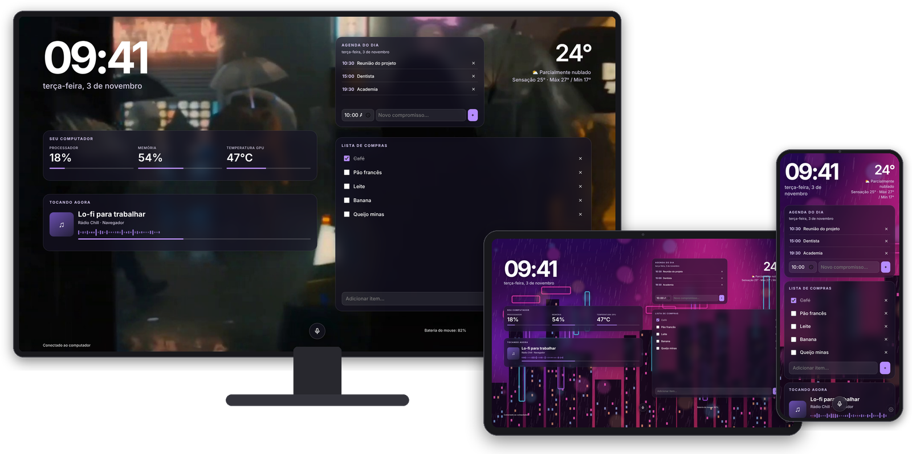
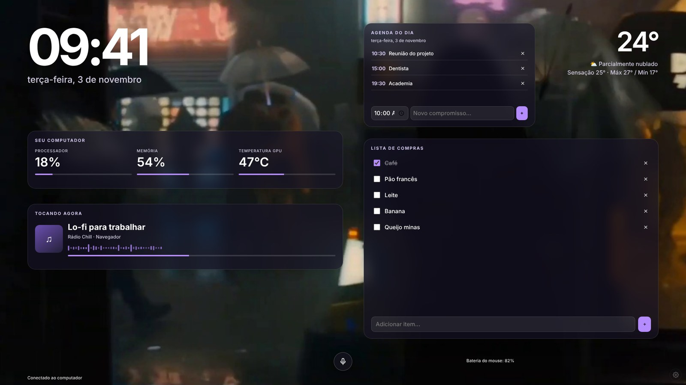
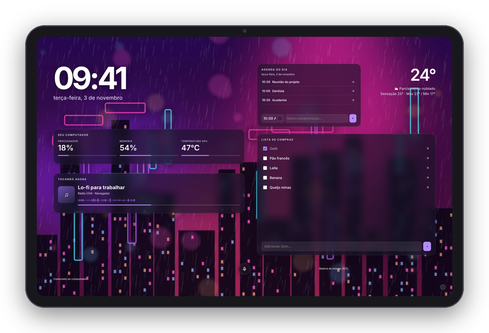
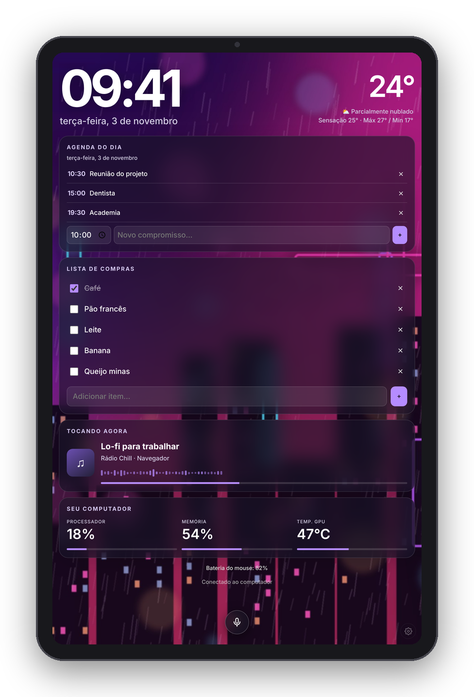
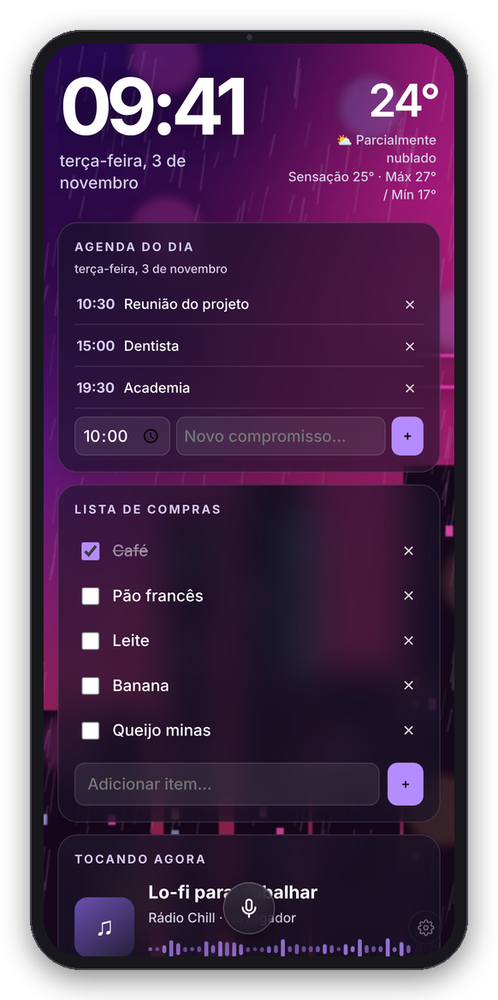
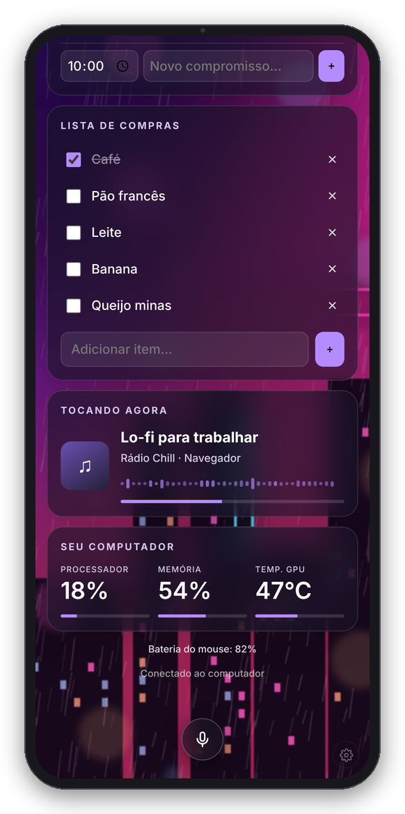
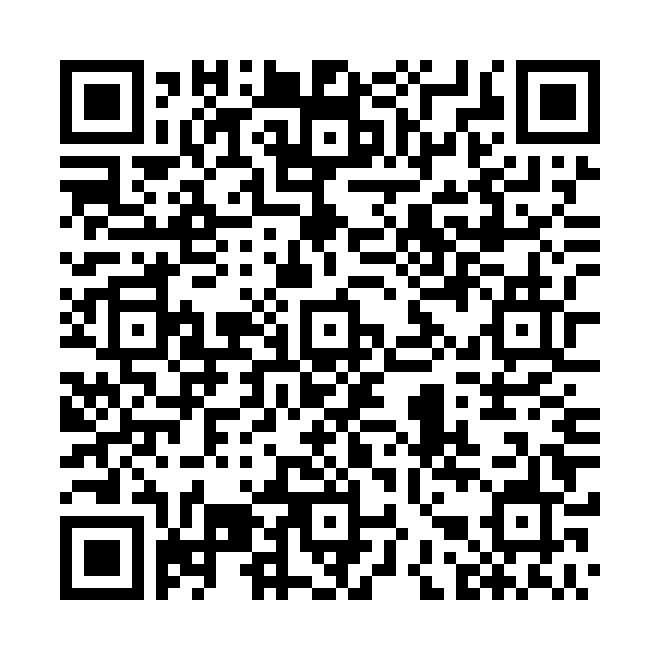

# Tela Tablet



> Curtiu? [**Apoie o projeto com um Pix ☕**](#-apoie-o-projeto)

Transforma um tablet ou celular Android velho num **painel de mesa** ligado ao seu PC com Windows: relógio, clima, agenda, lista de compras, o que está tocando no PC, uso de CPU/RAM/temperatura e um assistente de voz simples, tudo com fundo animado e visual de vidro.

O PC roda um servidor pequeno em Python. O tablet (ou o próprio navegador do PC) abre o painel pela rede Wi-Fi de casa. Nada vai para a nuvem: lista, agenda e ajustes ficam salvos no seu PC.

## O que tem

- **Relógio e clima** (Open-Meteo, sem chave de API) com a cidade que você escolher.
- **Agenda do dia** e **lista de compras** compartilhadas entre PC, tablet e celular.
- **Tocando agora**: música do Spotify ou do navegador, pela sessão de mídia do Windows.
- **Seu computador**: uso de processador, memória e temperatura (GPU NVIDIA automática; CPU com o LibreHardwareMonitor).
- **Bateria do mouse** Attack Shark/Xenta (opcional).
- **Assistente de voz "Chat"**: “põe café na lista”, “marca dentista amanhã às duas da tarde”, “o que tenho amanhã?”. Funciona por regras locais, sem IA paga.
- **Layout editável**: no PC, arraste e redimensione os quadros; o tablet mostra igualzinho.
- **Layout vertical** automático no celular/tablet em pé.
- **Fundos** em vídeo, GIF ou imagem.
- **Ícone na bandeja do Windows**: o servidor roda escondido, sem janela de terminal.

## Telas

| PC (horizontal) | Tablet deitado |
|---|---|
|  |  |

| Tablet em pé | Celular |
|---|---|
|  |   |

No PC você arrasta e redimensiona os quadros; o tablet deitado mostra exatamente o mesmo layout. Em pé, o painel troca sozinho para um layout vertical com rolagem. O fundo é por sua conta: imagem, GIF ou vídeo em loop (nas prints, cada aparelho está com um diferente).

## Requisitos

- Windows 10 ou 11 com **Python 3.11+** ([python.org](https://www.python.org/downloads/), marque “Add Python to PATH”).
- Tablet/celular **Android 8+** na mesma rede Wi-Fi do PC.
- Para compilar o app (opcional): **Android Studio**.

## Como usar

### 1. No PC

1. Baixe o projeto (botão **Code → Download ZIP**) e extraia numa pasta.
2. Dê dois cliques em **`abrir_windows.bat`**.
   - Na primeira vez ele instala a integração de música do Windows (precisa de internet).
   - Aparece um ícone roxo perto do relógio do Windows (na setinha **^** dos ícones ocultos) e o painel abre.
3. Clique com o botão direito no ícone → **Copiar endereço do tablet**. É algo como `http://192.168.0.20:47811`.
4. Se o Windows perguntar sobre o firewall, permita em **rede privada**.

Menu do ícone: abrir painel, copiar endereço, abrir pasta, **iniciar com o Windows** e sair.
Se algo der errado, rode `iniciar.bat` (mostra o terminal com os erros) ou veja `data/tray.log`.

### 2. No tablet/celular

1. Baixe o APK direto no aparelho: [**⬇️ TelaTablet-1.8.apk**](https://github.com/MarcosBPlz/tela-secundaria-android-windows/raw/main/apk/TelaTablet-1.8.apk) (também fica na pasta [`apk/`](apk/)).
2. Abra o arquivo e instale. Se o Android pedir, permita instalar de "fontes desconhecidas".
3. Abra o app, cole o endereço do PC e toque em **Conectar**.
4. Toque no microfone e permita o acesso quando pedir.

> Quer compilar você mesmo? Abra a pasta `android/` no **Android Studio** e use **Build → Generate App Bundles or APKs → Generate APKs**.

Sem instalar nada, também dá para abrir o endereço direto no navegador do tablet (mas a voz funciona melhor no app).

### Ajustes

Toque na engrenagem discreta no **canto inferior direito** (ou deslize da borda direita para a esquerda). Ali você muda cidade, cor, fundo, tamanho dos elementos, quais quadros aparecem e, no app, a orientação da tela.

### Assistente de voz

Toque no microfone e fale, começando ou não com “Chat”:

| Você diz | O que acontece |
|---|---|
| põe arroz, feijão e leite na lista | adiciona os três |
| tira o leite / comprei o café | remove / risca |
| o que tem na lista? | lê a lista |
| marca dentista amanhã às duas da tarde | cria o compromisso |
| reunião sexta às 9 e meia | cria o compromisso |
| o que tenho amanhã? / cancela o dentista | consulta / cancela |

O reconhecimento de fala é feito pelo serviço do Google no aparelho; o entendimento do pedido acontece no seu PC (`voice_assistant.py`).

### Temperatura do PC

- **Placa NVIDIA**: aparece sozinha (“Temperatura GPU”).
- **CPU**: abra o [LibreHardwareMonitor](https://github.com/LibreHardwareMonitor/LibreHardwareMonitor) e ligue *Options → Remote Web Server → Run* (porta 8085).

## Estrutura

```
server.py            servidor HTTP e APIs (status, lista, agenda, ajustes, voz)
tray.py              ícone na bandeja do Windows (inicia o servidor escondido)
index.html           o painel (HTML/CSS/JS, um arquivo só)
voice_assistant.py   interpreta os comandos de voz
temperature.py       leitura de temperatura (LibreHardwareMonitor / NVIDIA)
media_sessions.py    “tocando agora” via Windows Media Session
attackshark_battery/ bateria do mouse Attack Shark (MIT, projeto Attack Shark Battery Tray)
android/             app Android (WebView + reconhecimento e síntese de voz)
data/                seus dados (lista, agenda, ajustes) — não vão para o Git
media/               seus fundos — não vão para o Git
```

A porta padrão é `47811` (mude com a variável de ambiente `TABLET_PANEL_PORT`).

## ☕ Apoie o projeto

O Tela Tablet é grátis e sempre vai ser. Se ele te ajudou ou você curtiu a ideia, um Pix de qualquer valor ajuda a manter o projeto andando. Valeu demais! 💜



**Chave Pix (aleatória):**

```
a8016793-391a-4848-b69e-c5bc81a23f15
```

<details>
<summary>Pix Copia e Cola</summary>

```
00020126580014br.gov.bcb.pix0136a8016793-391a-4848-b69e-c5bc81a23f155204000053039865802BR5911TELA TABLET6009SAO PAULO62070503***63040955
```

</details>

Outra forma de ajudar: deixe uma ⭐ no repositório e mostre para a galera.

## Licença

MIT. A pasta `attackshark_battery/` deriva do projeto Attack Shark Battery Tray, também sob licença MIT (veja o `LICENSE` dentro dela).
